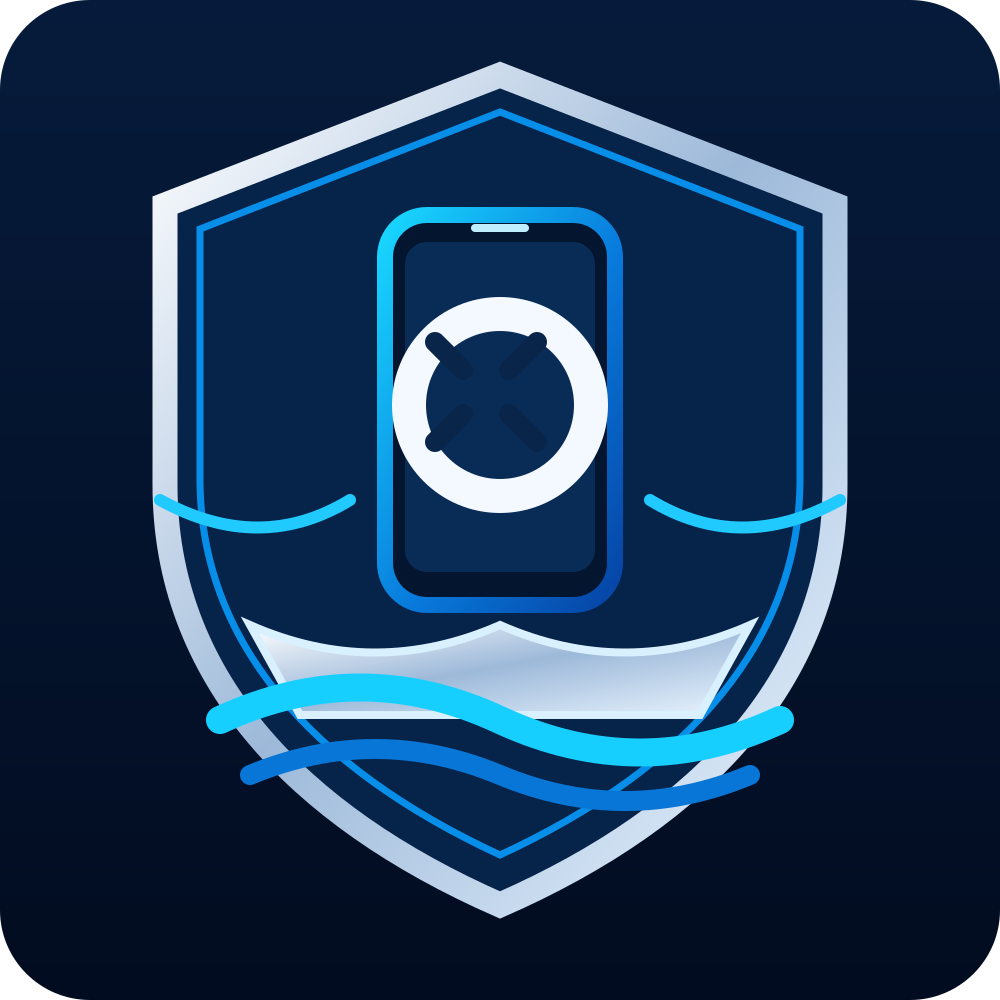

<p align="center">
  
</p>

# LIFEBOAT

## Android APK downloads

The latest verified Android debug APK is published by the **Android Sentinel checks** workflow:
[Open the latest successful Android workflow](https://github.com/Tajoor621/LIFEBOAT/actions/workflows/android-agent.yml).

Open the newest successful run on `main`, then download the
`lifeboat-sentinel-debug-<commit-sha>` artifact. It contains
`app-debug.apk` and `app-debug.apk.sha256`. Artifacts are retained for
90 days. The workflow uploads only after unit tests, lint, APK assembly,
and the least-privilege manifest check all pass.

The debug APK uses the stable package ID `com.tajoor621.lifeboat` (matching the LIFEBOAT app identity). CI now checks the package ID and APK signature before publishing. It is still signed with the runner's debug key, not a persistent production key; do not rely on it for seamless upgrades across different CI runs. Verify the checksum before installing. A successful CI build does not replace physical
device acceptance testing.


**Honest, owner-controlled device backup, recovery, and loss response.**

LIFEBOAT helps people preserve data before device loss, assess what is genuinely recoverable, restore verified backups, and respond safely when a device is lost.

## Non-negotiable reality contract

- Device data is readable only when software is installed and the owner has granted the required permissions.
- If a device is gone, backup was disabled, and no independent cloud copy survives, its local-only data is not recoverable.
- No bypass of device locks, file-based encryption, Activation Lock, FRP, MDM, or account authentication.
- Collection is visible, owner-consented, and auditable. No covert monitoring or stalkerware.
- Recovery claims are evidence-based. No simulated scans, fabricated progress, or unsupported promises.
- Destructive actions require verified backup evidence, an actual restore rehearsal, explicit confirmation, and a safe alternative.

## Roadmap

1. **P0 — Reality and architecture:** platform constraints, truth table, threat model, and ADRs.
2. **P1 — Core crypto, manifests, and vault:** client-side encryption primitives, versioned manifest encoding, immutable ciphertext storage, and authenticated HTTP transport.
3. **P1.5 — Integration and security validation:** cross-layer failure tests, restore integrity checks, API abuse tests, and container build verification.
4. **P1.6 — Vault hardening:** route-level body limits, versioned credential rotation, hash-linked audit ledger, locked builds, and container smoke tests. Automated CI passed; operator acceptance remains open.
5. **P2.0 — Android Sentinel foundation:** permission-free Android shell, explicit-consent model, permission matrix, validation plan, and Android CI.
6. **P2.1 — Onboarding and consent:** saved owner-selected categories and withdrawal.
7. **P2.2 — Contacts snapshot:** owner-initiated read-only Contacts Provider query, VCF 4.0 export, and local evidence; no upload.
8. **P2.3–P2.6 — Android backup agent:** media inventory, client-side encryption, resumable upload, and restore rehearsal.
9. P3 — Recovery decision engine and evidence-based reports.
10. P4 — Cloud connectors and export ingestion.
11. P5 — In-hand rescue workflows.
12. P6 — Authenticated remote commands and guarded wipe state machine.
13. P7 — Rehydration, restore rehearsal, scheduler, and documentation.

## Current implementation

- `decision-engine/`: four-state evidence-based recoverability evaluator.
- `core-crypto/`: XChaCha20-Poly1305 envelopes, Argon2id key derivation, dual passphrase/recovery-code vault-key wrapping, keyed BLAKE3 object identifiers, Ed25519 signing/strict verification, versioned snapshot manifests, and a scratch restore-rehearsal verifier.
- `vault/`: local immutable ciphertext storage plus an Axum HTTP API with pre-body per-device bearer authentication, route-level body limits, versioned active/previous token digests, per-device rate/storage limits, immutable object and manifest writes, digest-verified reads, and persistent resumable chunk uploads.
- `vault/src/audit.rs`: startup-verified, hash-linked JSONL audit ledger for successful write transitions.
- `android-agent/`: Kotlin Android app (minSdk 26, targetSdk 35). P2.1 provides explicit saved consent; P2.2 adds a separately initiated read-only Contacts export to VCF 4.0. The only declared Android permission is `READ_CONTACTS`; no network permission or background collection component is present.
- `docs/P2_ANDROID_SENTINEL_ARCHITECTURE.md`: Android architecture, safety invariants, sequencing, and evidence model.
- `docs/P2_PERMISSION_MATRIX.md`: data-class capability and permission boundaries.
- `docs/P2_VALIDATION_PLAN.md`: automated and device-level P2 validation requirements.
- `docs/P2.2_CONTACTS_SNAPSHOT.md`: Contacts export scope, permission behavior, evidence, and limitations.
- `docs/VAULT_API.md` and `docs/P1.6_HARDENING.md`: API protocol, credential rotation, audit ledger, deployment constraints, and security limitations.
- `docs/RECOVERY_KIT.md`: offline key recovery, owner-handling rules, and restore-rehearsal evidence boundaries.
- `docs/REALITY.md`: platform constraints and release gates.
- `THREAT_MODEL.md`: threats, controls, and wipe safety gate.
- `docs/RecoverabilityTruthTable.md`: normative per-data-class status rules.

This remains an early-stage foundation, **not a production-ready backup service**. P1.6 automated validation passed, but operator deployment, interrupted-upload and independent-restore rehearsals, TLS/firewall configuration, and independent security review remain required. P2.2 is a local contacts export, not a complete backup: it does not encrypt or upload data and does not claim every provider-specific field is covered. Real-device testing on Samsung One UI and other Android versions remains mandatory. The vault accepts opaque encrypted bytes only and does not decrypt backups. Do not expose the API directly to the public Internet.

## Local development

Rust workspace:
```sh
cargo fmt --all -- --check
cargo test --locked --workspace --all-targets
cargo clippy --locked --workspace --all-targets -- -D warnings
cargo build --locked --workspace --release
```

Android Sentinel:
```sh
cd android-agent
gradle --no-daemon :app:testDebugUnitTest :app:lintDebug :app:assembleDebug
```

## Self-hosted container

See `docs/VAULT_API.md` and `docs/P1.6_HARDENING.md`. Create `secrets/credentials.json` from `config/credentials.example.json`, replace the placeholder digest, set owner UID 10001 and mode 0600, then run `docker compose up --build -d`. The Compose file publishes only host loopback. Use a TLS reverse proxy and restricted network access for remote clients.

## Architecture

- Android agent: Kotlin, minSdk 26+
- Shared core and vault: Rust
- Desktop console: Tauri + React (planned)
- Local metadata and queues: SQLite (planned)
- Encrypted blob storage: local filesystem; S3-compatible adapter not implemented
- Self-hosting: Docker Compose; Raspberry Pi and VPS are targets subject to measured resource limits

## Safety and licensing

Use only for devices and accounts you own or are explicitly authorized to administer. Server and agent applications are planned AGPL-3.0-or-later; reusable core libraries are MIT. License boundaries and files must be finalized before release.
